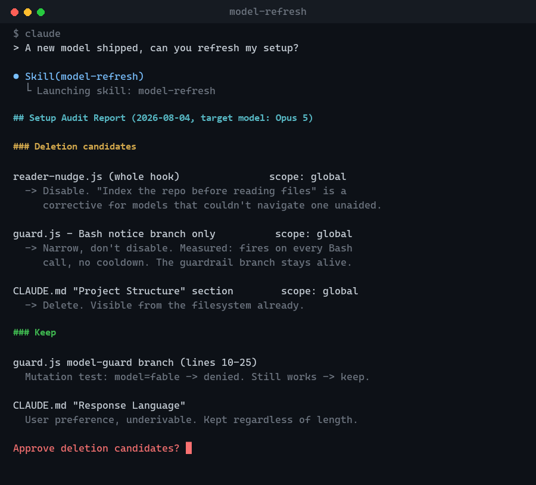

# model-refresh

[](LICENSE)

A [Claude Code](https://claude.com/claude-code) (and [Codex CLI](https://developers.openai.com/codex)) skill that audits every AI coding agent setup installed on your machine — plugins, hooks, agents, skills, MCP connectors, and CLAUDE.md/AGENTS.md — against one question:

> **On the model you run today, does this instruction still help keep your contract — or does it now cause needless stops, over-execution and conflicts?**

A setup is always tuned for the model that's two generations behind whatever you're running now — an observation from [Boris Cherny](https://github.com/bcherny), creator of Claude Code. Instructions written as corrective devices for an older model turn into context cost and behavioral distortion. `/model-refresh` is the workflow for re-checking them every time a new model ships. "The model could work this out itself" is not enough to delete something: your own policies and your tool and project contracts stay, and candidates are judged against official model guidance, the current runtime, and how the instruction was actually used.


*Turn sprawling configuration into a setup tuned for today’s models.*



*A real Phase 0–3 run captured against the synthetic fixture in [`evals/fixture-home`](evals/fixture-home) — nothing here touches a real `~/.claude`. Full report excerpted for length; see [`evals/evals.json`](evals/evals.json) id 1 to reproduce it yourself.*

## Why this exists

`/doctor` checks configuration correctness. It doesn't tell you that a plugin is injecting a paragraph into every prompt for a problem the current model no longer has, that a hook's guardrail is about to die along with its annoying notice if you disable the whole script, or that a skill you installed for one project is now loaded — and silently competing for the model's attention — in every project you open.

If you run both Claude Code and Codex CLI, there's a third blind spot: nothing tells you that the same skill now exists as two independent copies that will quietly drift apart the next time you edit one and forget the other.

`model-refresh` covers three layers neither tool's own doctor sees:

- **Providers** — plugins, hooks, agent descriptions, the skill list, MCP connectors: the *sources* of instructions, not their content.
- **Content** — a line-by-line pass over global and project `CLAUDE.md`/`AGENTS.md`, judged by the same standard, with every deletion proposal shown as a quoted line and gated behind your explicit approval.
- **Cross-tool duplication** — if Claude Code and Codex CLI are both installed, checks whether the same skill exists as an independent copy in both, and proposes one canonical copy plus a junction/symlink instead of two copies that can silently diverge.

## What it actually does

Five phases, with a hard approval gate before anything changes:

1. **Load prior audits** — diffs against the last run instead of starting cold every time.
2. **Concurrent-session preflight** — checks file mtimes so two sessions editing the same config file at once don't silently clobber each other.
3. **Inventory** — collects plugins, hooks, agents, skills, MCP connectors, and usage data, for every tool home that actually exists (`~/.claude`, `~/.codex`) — [Claude-side](references/claude-inventory.md) / [Codex-side](references/codex-inventory.md) detail.
4. **Judgment** — classifies every item as *deletion candidate*, *keep*, *cross-tool integration candidate*, or *needs your judgment*, against evidence, not impression — see [Judgment rules](references/audit-rules.md).
5. **Completion-check review** — your test suites, QA gates, and pass/fail bars age too. Contract checks are fed the violation they were built to catch; comparison evals are checked for whether they still discriminate. A new model release alone expires nothing.
6. **Report → approval → apply → runtime verification → record.** Nothing gets touched before you say so, item by item. Runtime-affecting changes (MCP, plugins, hooks) are confirmed with an actual headless init event — not just a file re-read — because [a file can say one thing while the runtime reads another](references/runtime-verify.md).

Optional **deep mode** (`/model-refresh deep`) adds a controlled comparison per candidate: same model, same task, same environment, only the candidate instruction changed. If nothing differs, the report says the sample showed no difference — not that the instruction is proven useless.

## Approving is one click — no files to move

The audit opens as a local HTML report. Each proposal has a number, its evidence, the exact diff, and approve / reject / defer buttons.

- Press **Submit decisions** in the report and the waiting session receives them directly. There is no JSON to download, upload, or point to.
- Or skip the buttons and answer in the chat: "approve 1 and 3, reject 2", or "approve everything". Anything you don't mention is deferred and left untouched.
- If the report was opened as a plain file (remote or cloud sessions), the same button copies a short text to paste into the chat.

Your click or your chat message is the approval. A decisions file that shows up any other way authorizes nothing.

## The completion report is derived, not recalled

After applying, the run's record is checked before anything is reported back: every item must say whether it was applied, what was observed, and at which level — **config** (the file or CLI state shows it) or **runtime** (a fresh session was seen behaving that way). The record is compared with what you actually approved and with the files the diffs name. If they disagree, there is no completion report until it's fixed.

What you get reads like this, and always includes what the run did *not* establish:

```
## model-refresh completion report — partially complete
- Decisions: approved 3 · rejected 1 · deferred 0
- Applied: 2 of 3 approved items applied
- Verified: observed at runtime 1 · config/file state only 1 · unverified 0 · failed 0
### What this run does not establish
- 1 item(s) were checked in config/file state only, not in a fresh session.
- Cost, speed and quality effects were not measured.
```

## Install

**Claude Code:**

```bash
# user-scope (available in every project)
git clone https://github.com/gupilleveldesigner/model-refresh ~/.claude/skills/model-refresh

# or project-scope (this project only)
git clone https://github.com/gupilleveldesigner/model-refresh .claude/skills/model-refresh
```

**Codex CLI:** same idea, different directory — `~/.codex/skills/model-refresh` (or a project-local `.codex/skills/model-refresh`). This repo ships `agents/openai.yaml` so Codex picks it up as `$model-refresh` alongside Claude's `/model-refresh`.

Then just talk to it — no separate install step beyond the file copy. If you have both tools installed and want one canonical copy instead of two independent clones to keep in sync by hand, clone it once to a shared location and point both `~/.claude/skills/model-refresh` and `~/.codex/skills/model-refresh` at it with a junction (Windows) or symlink (Unix) — which is exactly the kind of setup this skill's cross-tool duplication check is designed to recognize as healthy, not flag.

## Usage

```
/model-refresh          # standard audit
/model-refresh deep     # + controlled per-candidate comparison
```

It also triggers on natural language: "clean up my setup," "why does my context feel bloated," "I ran /doctor and nothing changed," "a hook keeps injecting something weird," "there are too many skills unrelated to this project," "a connector says it's connected but doesn't work," "audit my Claude and Codex setup together," and similar. For a one-line config change (add a permission, set an env var), it correctly stays out of the way — that's a job for a plain config edit, not a full audit.

## Design notes

- **Safety-first**: every change is reversible — disable over delete, backup before modify, and a re-check of file mtimes immediately before applying in case another session touched the same files mid-audit.
- **Evidence over impression**: a frequency claim like "this hook fires on every message" only makes it into the report if it's backed by reading the hook body, a throttle/state file, or an actual count from the transcript. Guessing wrong here has cost real users a working guardrail alongside the noise they meant to silence — see [`references/audit-rules.md`](references/audit-rules.md) for the incident.
- **Scope discipline**: "unused in this project" is not "safe to disable globally." The rules force a check across other projects before anything gets turned off outside project scope.
- **Only a human can approve**: approval is your click in the report or your message in the chat. If this skill somehow runs inside an autonomous loop or another agent's context with nobody around to approve, it stops at the report and refuses to apply anything.
- **No overstated "done"**: "applied" and "seen working" are recorded separately, and the completion message is generated from the checked record rather than written from memory.
- **Honest about what isn't verified yet**: Claude Code has a proven headless procedure for confirming a runtime-affecting change actually took effect (not just that the file changed). Codex CLI doesn't have a confirmed equivalent yet — the skill says so explicitly ("unverified (Codex)") instead of pretending a file re-read is proof.

## Repo layout

```
SKILL.md                        entry point Claude Code (and Codex, via agents/openai.yaml) reads
agents/openai.yaml              Codex-facing manifest ($model-refresh)
references/
  claude-inventory.md           Claude Code-specific Phase 1 collection procedure
  codex-inventory.md            Codex CLI-specific Phase 1 collection procedure
  audit-rules.md                the 3-question judgment standard + category-specific rules,
                                 including cross-tool duplication
  apply-protocol.md             Phase 4 delegated-agent prompt template + safety rules
                                 (incl. TOML-safe editing, junction/symlink conversion)
  runtime-verify.md             headless init-event verification procedure (Claude);
                                 honest gap notice for Codex
  eval-expiry.md                Phase 2b completion-check review
  deep-baseline.md              deep-mode controlled comparison
  model-evidence.md             official-guidance matrix for model migrations
  skill-usage-evidence.md       judging skills by their actual usage spans
  report-contract.md            report.json / decisions / Phase 5 evidence contract
scripts/
  review_server.py              shows the report, receives the submitted decisions
  record_decisions.py           records decisions given in chat
  validate_decisions.py         pre-apply check that decisions match the report
  finalize_run.py               verifies the run record and prints the completion report
  render_report.py              report.json → self-contained report.html
  validate_report.py            evidence and stage contract checks
evals/                          trigger + task fixtures for measuring this skill's own quality
                                 (excluded from the packaged skill — see evals/README.md)
```

## Evals

`evals/` ships a synthetic fixture home (`evals/fixture-home/`) with five deliberately planted defects — a duplicate project key, a hook mixing a notice with a real guardrail, project-scoped skills that shouldn't be disabled globally, a hook with a cooldown that a naive report would call "every time," and a rejected proposal that shouldn't be re-raised. Nothing in the fixtures is real user data. See [`evals/README.md`](evals/README.md) for how to run them, for a documented set of Windows-specific harness bugs (and their fixes) if you're evaluating on that platform, and for the current coverage gap (Codex-side inventory and cross-tool duplication have trigger-phrase coverage but no fixture-based task eval yet).

## License

[MIT](LICENSE)
